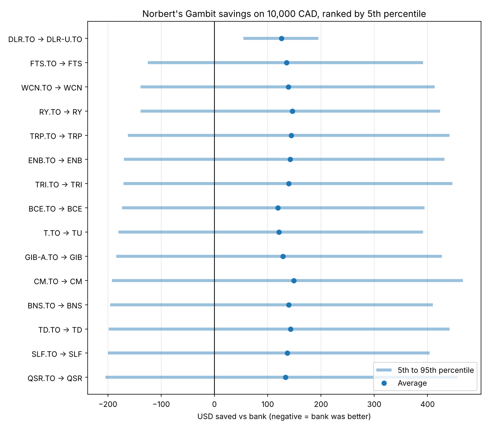

# Norbert's Gambit Optimizer

What is the cheapest way to turn Canadian dollars into US dollars? This tool
backtests the bank against **Norbert's Gambit** with 44 different securities
(DLR plus 43 Canadian companies that also trade in New York), on every
possible start date, and recommends the method to use for the amount you want
to convert.

## The answer (Jan 2021 to Dec 2025, real Yahoo Finance prices)

With default costs (2% bank spread, 9.95 commission per trade, 0.05% bid-ask
cost per trade, 4 trading days to journal the shares):

- **Use DLR.TO → DLR-U.TO.** It ranked first out of 44. On 10,000 CAD it saved
  126 USD on average and beat the bank on 99.5% of 1,249 start dates.
- **The security choice doesn't raise your average saving, only your risk.**
  Every security saved roughly the same on average (119 to 228 USD on
  10,000 CAD), because the saving comes from skipping the bank's spread.
  What differs is how much the price moves while you wait for the journal:
  DLR tracks the US dollar, so it barely moves; stocks can swing several
  percent. With BlackBerry, the worst start date lost 4,069 USD compared with
  the bank.
- **Below about 1,200 CAD, use the bank.** The two commissions cost more than
  the spread you save. With commission-free trading, the Gambit wins at any
  amount.
- **If your broker lets you sell the USD side right away**, before the journal
  settles, the waiting risk disappears: DLR's 5th-percentile saving on
  10,000 CAD rises from 55 to 116 USD.



### Top 10 on 10,000 CAD, ranked by 5th-percentile saving

The 5th percentile is the "bad case": in 95% of start dates you did at least
this well.

| Rank | Security | Avg saving (USD) | 5th pct (USD) | Worst (USD) | Beat bank | Break-even (CAD) |
| ---: | --- | ---: | ---: | ---: | ---: | ---: |
| 1 | DLR.TO → DLR-U.TO (Global X US Dollar Currency ETF) | 126 | 55 | -60 | 99.5% | 1,224 |
| 2 | FTS.TO → FTS (Fortis) | 135 | -125 | -534 | 81.4% | 1,165 |
| 3 | WCN.TO → WCN (Waste Connections) | 139 | -139 | -669 | 80.2% | 1,208 |
| 4 | RY.TO → RY (Royal Bank of Canada) | 146 | -139 | -575 | 82.1% | 1,134 |
| 5 | TRP.TO → TRP (TC Energy) | 144 | -162 | -515 | 77.1% | 1,091 |
| 6 | ENB.TO → ENB (Enbridge) | 142 | -170 | -694 | 80.8% | 1,121 |
| 7 | TRI.TO → TRI (Thomson Reuters) | 139 | -171 | -780 | 79.1% | 1,189 |
| 8 | BCE.TO → BCE (BCE) | 119 | -174 | -788 | 78.0% | 1,298 |
| 9 | T.TO → TU (TELUS) | 121 | -180 | -701 | 77.8% | 1,268 |
| 10 | GIB-A.TO → GIB (CGI) | 128 | -184 | -681 | 77.2% | 1,249 |
| 44 | BB.TO → BB (BlackBerry) | 139 | -819 | -4,069 | 58.7% | 1,117 |

The full table for all 44 is written to `output/ranking.csv`.

### Best method by amount

| Amount (CAD) | Recommended | Avg saving (USD) | 5th pct (USD) |
| ---: | --- | ---: | ---: |
| 1,000 | Bank | 0 | 0 |
| 2,500 | Gambit with DLR | 18 | 1 |
| 5,000 | Gambit with DLR | 54 | 19 |
| 10,000 | Gambit with DLR | 126 | 55 |
| 25,000 | Gambit with DLR | 340 | 162 |
| 50,000 | Gambit with DLR | 698 | 340 |
| 100,000 | Gambit with DLR | 1,414 | 698 |

The Gambit is recommended only when the best security beat the bank in at
least 95% of start dates; otherwise the bank is the safer choice.

### Other scenarios (10,000 CAD, DLR)

| Scenario | Avg saving (USD) | 5th pct (USD) | Break-even (CAD) |
| --- | ---: | ---: | ---: |
| Default | 126 | 55 | 1,224 |
| Sell the USD side immediately (`--delay 0`) | 125 | 116 | 1,228 |
| Bank spread 1.5% instead of 2% (`--spread 0.015`) | 88 | 17 | 1,657 |
| No commissions (`--commission 0`) | 143 | 71 | 100 or less |
| Triple the bid-ask cost (`--slippage-bps 15`) | 111 | 40 | 1,365 |

DLR ranked first in every scenario.

## How Norbert's Gambit works

1. Buy a security listed in both currencies with CAD (DLR.TO, or a company
   such as RY.TO).
2. Ask your broker to journal the shares to the USD listing (DLR-U.TO, or RY
   on the NYSE).
3. Sell the shares for USD.

You skip the bank's FX spread but pay two commissions and a bid-ask cost, and
the price can move while the journal settles.

## Model

| Method | USD received |
| --- | --- |
| Bank | CAD × CADUSD × (1 − spread) |
| Norbert's Gambit | whole shares bought on day *t* at the CAD close plus slippage; dividends with an ex-date during the wait; sold on day *t + delay* at the USD close minus slippage; minus both commissions; leftover CAD goes through the bank |

Commissions can be flat (`--commission 9.95`) or per share with a minimum and
maximum (`--commission 0 --per-share 0.01 --commission-min 4.95
--commission-max 9.95`).

## Data checks

- **DLR-U.TO has no history on Yahoo Finance**, so its price is estimated as
  DLR.TO × CADUSD (both are units of the same fund). Checked against 276
  five-minute quotes from 16 to 19 Nov 2026: the real DLR-U.TO price was within
  ±0.1% of the estimate 90% of the time (median gap 0.00%), about ±7 USD on
  10,000 CAD.
- **One-sided adjustments are caught.** Both listings are the same share, so
  USD price ÷ (CAD price × CADUSD) should be close to 1. Days off by more than
  3% are flagged, and any start date whose holding window touches one is
  skipped. This caught TC Energy's October 2024 South Bow spin-off: Yahoo
  adjusted TRP.TO's history by about 10% but not TRP's, which made TRP look like
  it saved 878 USD per 10,000 CAD before the fix.

## Install

```bash
git clone https://github.com/yliu54977-bot/Smart-Norbert-s-Gambit-Optimizer.git
cd Smart-Norbert-s-Gambit-Optimizer
python -m venv .venv && source .venv/bin/activate
pip install -e ".[dev]"
```

## Usage

Rank every security and get a recommendation (downloads prices with yfinance):

```bash
norbert-optimizer rank --amount 10000 --start 2021-01-01 --end 2025-12-31 --save-data prices.csv
```

Re-run from the saved prices without downloading:

```bash
norbert-optimizer rank --amount 10000 --data prices.csv --delay 0 --commission 0
```

Look at one security in detail, including how the result changes with the
journal delay:

```bash
norbert-optimizer compare --amount 10000 --pair RY --data prices.csv
```

Offline demo with made-up prices:

```bash
norbert-optimizer compare --amount 10000 --csv data/sample_synthetic.csv
```

Main options: `--spread`, `--commission`, `--per-share`, `--commission-min`,
`--commission-max`, `--delay`, `--slippage-bps`, `--max-gap`, `--amounts`,
`--top`, `--out`, `--json`.

`rank` writes `ranking.csv`, `best_by_amount.csv` and `ranking.png`; `compare`
writes two charts (USD by start date, distribution of savings).

## Tests

```bash
pytest
```

25 tests check the formulas against hand calculations (commissions, per-share
fees, slippage, leftover cash, dividends, the settlement delay), the data
checks, the ranking and recommendation rules, the command line, and the
yfinance download (with a fake yfinance, so tests run offline).

## Limitations

- Daily closing prices, not intraday quotes. The CADUSD close is recorded at a
  different time from the 4 pm stock close, which adds some noise.
- Taxes are ignored (a price change during the wait can be a capital gain or
  loss).
- The journal is assumed to take exactly `--delay` trading days.
- Not every broker journals every interlisted stock; check with yours.
- Past results do not guarantee future savings. This is not financial advice.

## Project layout

```
src/norbert_optimizer/
    universe.py  the 44 securities tested
    data.py      download, load, check and align prices
    models.py    bank and Gambit simulations
    stats.py     summary statistics and break-even amount
    rank.py      ranking, recommendation, best method by amount
    plots.py     charts
    cli.py       command line (rank, compare)
tests/           pytest tests
scripts/         synthetic sample data generator
data/            synthetic sample CSV
docs/            charts used in this README
```
