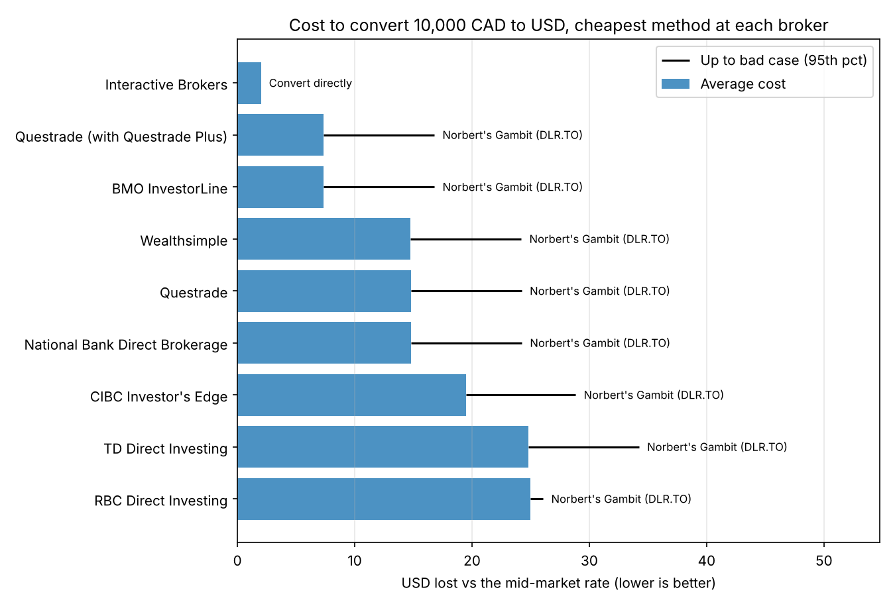

# Norbert's Gambit Optimizer

What is the cheapest way to turn Canadian dollars into US dollars, at your
broker? This tool backtests your broker's own conversion against **Norbert's
Gambit** with 44 securities (DLR plus 43 Canadian companies that also trade
in New York), on every start date from 2021 to 2025, using each broker's real
fees and rules: commissions, journal fees, tiered FX spreads, which
securities it lets you journal, and how long you wait.

## The answer (2021 to 2025, real Yahoo Finance prices; fees checked 2026-11-20)



Cost of converting **10,000 CAD**, in USD lost compared with the mid-market
rate (lower is better):

| Broker | Cheapest safe method | Avg cost (USD) | Bad case, 95th pct (USD) | Direct conversion (USD) |
| --- | --- | ---: | ---: | ---: |
| Interactive Brokers | Convert directly | 2.00 | 2.00 | 2.00 |
| Questrade (with Questrade Plus) | Norbert's Gambit (DLR) | 7.32 | 16.79 | 112.63 |
| BMO InvestorLine | Norbert's Gambit (DLR) | 7.32 | 16.80 | 120.14 |
| Wealthsimple | Norbert's Gambit (DLR) | 14.75 | 24.20 | 75.09 |
| Questrade | Norbert's Gambit (DLR) | 14.78 | 24.24 | 112.63 |
| National Bank Direct Brokerage | Norbert's Gambit (DLR) | 14.79 | 24.25 | 127.65 |
| CIBC Investor's Edge | Norbert's Gambit (DLR) | 19.49 | 28.84 | 120.14 |
| TD Direct Investing | Norbert's Gambit (DLR) | 24.79 | 34.24 | 94.61 |
| RBC Direct Investing | Norbert's Gambit (DLR) | 24.99 | 26.07 | 120.14 |

- **At every broker that supports it, the Gambit beats the broker's own
  conversion**, saving about 60 to 113 USD on 10,000 CAD.
- **Use DLR, not a stock.** DLR was the best security at every broker. Stocks
  save about the same on average, but their price moves while the shares are
  journaled; with Shopify the worst start date lost 2,290 USD against a bank.
- **Interactive Brokers doesn't need the Gambit**: its direct conversion
  costs 0.002% with a US$2 minimum.
- **Commission-free brokers with no journal fee are cheapest for the Gambit**
  (BMO InvestorLine, Questrade Plus). A 9.95 CAD journal fee adds about 7 USD.
- **RBC lets you sell DLR.U right away**, so there is no waiting at all: its
  cost barely varies (25.0 USD on average, 26.1 in the bad case). It costs
  more only because of its 9.95 commissions.

Average cost (USD) of each broker's recommended method by amount (CAD):

| Broker | 1,000 | 2,500 | 5,000 | 10,000 | 25,000 | 50,000 | 100,000 |
| --- | ---: | ---: | ---: | ---: | ---: | ---: | ---: |
| Interactive Brokers | 2.00 | 2.00 | 2.00 | 2.00 | 2.00 | 2.00 | 2.00 |
| Questrade (with Questrade Plus) | 0.80 | 1.88 | 3.70 | 7.32 | 18 | 36 | 73 |
| BMO InvestorLine | 0.80 | 1.89 | 3.70 | 7.32 | 18 | 36 | 73 |
| Wealthsimple | 8.26 | 9.35 | 11 | 15 | 26 | 44 | 0.00* |
| Questrade | 8.26 | 9.35 | 11 | 15 | 26 | 44 | 80 |
| National Bank Direct Brokerage | 8.27 | 9.36 | 11 | 15 | 26 | 44 | 80 |
| CIBC Investor's Edge | 12 | 14 | 16 | 19 | 30 | 48 | 85 |
| TD Direct Investing | 9.46 | 19 | 21 | 25 | 36 | 54 | 90 |
| RBC Direct Investing | 12 | 19 | 21 | 25 | 36 | 55 | 93 |

\*Wealthsimple charges no FX fee from 100,000 CAD, but the fee sits on top of
its own exchange rate, which already includes a spread that is not published.
The true cost is above zero.

Before you convert, check your broker's current rules:
`norbert-optimizer brokers --list` prints each broker's fees, how to request
the journal, notes, and the pages the numbers came from.

## Every security, ranked (10,000 CAD vs a bank's 2% spread)


| Rank | Security | Avg saving (USD) | 5th pct (USD) | Worst (USD) | Beat bank |
| ---: | --- | ---: | ---: | ---: | ---: |
| 1 | DLR.TO → DLR-U.TO (Global X US Dollar Currency ETF) | 126 | 112 | 33 | 100.0% |
| 2 | FTS.TO → FTS (Fortis) | 135 | -116 | -520 | 81.4% |
| 3 | WCN.TO → WCN (Waste Connections) | 139 | -133 | -628 | 80.8% |
| 4 | RY.TO → RY (Royal Bank of Canada) | 146 | -143 | -657 | 82.1% |
| 5 | TRP.TO → TRP (TC Energy) | 144 | -148 | -515 | 77.7% |
| 6 | ENB.TO → ENB (Enbridge) | 142 | -164 | -655 | 81.4% |
| 7 | BCE.TO → BCE (BCE) | 119 | -171 | -786 | 78.7% |
| 8 | TRI.TO → TRI (Thomson Reuters) | 139 | -173 | -786 | 79.7% |
| 44 | SHOP.TO → SHOP (Shopify) | 150 | -799 | -2,290 | 60.6% |

Every security saved 119 to 228 USD on average; DLR is the only one that
never lost to the bank in 1,249 start dates. Ranking is by the 5th
percentile: in 95% of start dates you did at least this well.

## How the comparison works

For each start date, with the broker's settings:

| Method | USD received |
| --- | --- |
| Direct conversion | CAD × CADUSD × (1 − broker's FX spread for that amount) |
| Norbert's Gambit | journal fee set aside; whole shares bought at the CAD close plus slippage; dividends during the wait; sold *delay* trading days later at the USD close minus slippage; minus both commissions; leftover CAD converted directly |

Costs are measured against the mid-market rate. Norbert's Gambit is
recommended only with a security that beat direct conversion in at least 95%
of start dates; among those, the one with the best 5th percentile.

## Data checks

- **Exchange rate at 4 pm.** Yahoo's daily CADUSD=X close is recorded at a
  different time from the 4 pm stock closes. Mixing them made DLR's USD value
  appear to jump 0.57% a day, although DLR simply holds US dollars (its USD
  value moved only from 9.93 to 10.35 over five years). The tool measures the
  4 pm rate from DLR's own price instead (`--fx-source dlr`, the default).
  This cut the gap between RY.TO and RY from 0.40% to 0.15% a day.
- **DLR-U.TO has no history on Yahoo Finance**, so its price is estimated as
  DLR.TO × CADUSD. Checked against 276 five-minute quotes from 16 to 19 Nov
  2026: the real price was within ±0.1% of the estimate 90% of the time.
- **One-sided adjustments are caught.** Days where USD price ÷ (CAD price ×
  CADUSD) is more than 3% from 1 are flagged, and start dates whose holding
  window touches one are skipped. This caught TC Energy's October 2024 South
  Bow spin-off, which Yahoo adjusted on TRP.TO but not on TRP.

## Broker data

Fees and rules are in `src/norbert_optimizer/brokers.py`, each with its
sources and a check date (2026-11-20). Where a broker does not publish a
number, it came from a recent third-party fee comparison and the broker is
marked `sources: mixed`. Known gaps:

- RBC, BMO, CIBC and National Bank: only the first FX tier (under $25,000) is
  known, so their direct conversion is overstated for larger amounts.
- TD's FX page mentions an extra affiliate surcharge, so TD's real direct
  cost may be higher than shown.
- Waiting times are 3 trading days unless the broker documents otherwise.

Every number can be overridden: `--commission`, `--journal-fee`, `--spread`,
`--delay`.

## Install

```bash
git clone https://github.com/yliu54977-bot/Smart-Norbert-s-Gambit-Optimizer.git
cd Smart-Norbert-s-Gambit-Optimizer
python -m venv .venv && source .venv/bin/activate
pip install -e ".[dev]"
```

## Usage

Download prices once, then reuse them:

```bash
norbert-optimizer brokers --amount 10000 --start 2021-01-01 --end 2025-12-31 --save-data prices.csv
```

Compare brokers, or see their rules and sources:

```bash
norbert-optimizer brokers --amount 25000 --data prices.csv
norbert-optimizer brokers --list
```

Best method at your broker, for every security and amount:

```bash
norbert-optimizer rank --amount 10000 --broker questrade --data prices.csv
```

One security in detail, including how the result changes with the wait:

```bash
norbert-optimizer compare --amount 10000 --broker td --pair DLR.TO --data prices.csv
```

Without `--broker`, the defaults are a 2% bank spread, 9.95 per trade and a
4-day wait. Other options: `--per-share`, `--commission-min`,
`--commission-max`, `--slippage-bps`, `--fx-source`, `--max-gap`,
`--amounts`, `--top`, `--out`, `--json`.

## Tests

```bash
pytest
```

34 tests check the formulas against hand calculations (commissions, per-share
fees, journal fees, slippage, leftover cash, dividends, the wait), tiered
broker FX, which securities each broker allows, the 4 pm exchange rate, the
data checks, the ranking and recommendation rules, the command line, and the
yfinance download (with a fake yfinance, so tests run offline).

## Limitations

- Daily closing prices, not intraday quotes.
- Taxes are ignored (a price change during the wait can be a capital gain or
  loss).
- Broker fees and rules change; they were checked on 2026-11-20.
- Monthly costs such as Questrade Plus or Wealthsimple's USD account are not
  included in the per-conversion cost.
- Past results do not guarantee future savings. This is not financial advice.

## Project layout

```
src/norbert_optimizer/
    brokers.py   broker fees, rules and sources
    universe.py  the 44 securities tested
    data.py      download, load, check and align prices; 4 pm exchange rate
    models.py    direct conversion and Gambit simulations
    stats.py     summary statistics and break-even amount
    rank.py      ranking, recommendation, broker comparison
    plots.py     charts
    cli.py       command line (brokers, rank, compare)
tests/           pytest tests
scripts/         synthetic sample data generator
data/            synthetic sample CSV
docs/            charts used in this README
```
