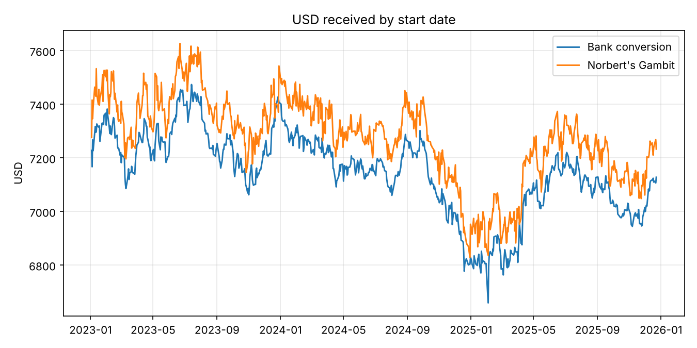
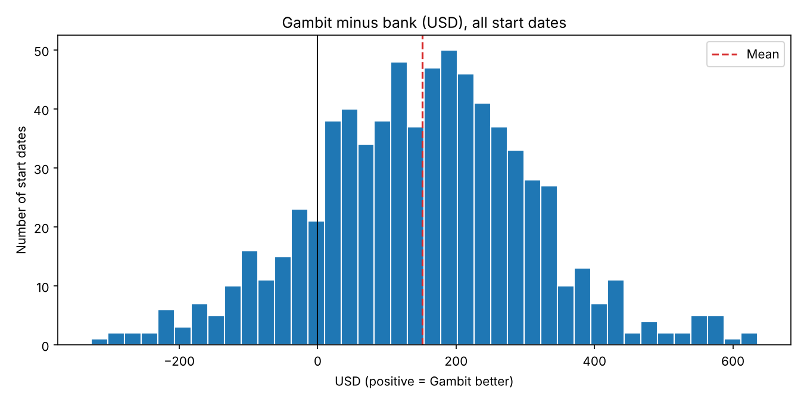

# Norbert's Gambit Optimizer

Should you convert Canadian dollars to US dollars at your bank, or use
**Norbert's Gambit**? This tool answers that on historical data: give it an
amount in CAD and a date range, and it tests both methods on every possible
start date, then reports the average savings, the risk, the best and worst
cases, and the break-even amount.

## How Norbert's Gambit works

1. Buy a stock listed in both currencies (default: DLR.TO, the CAD side of
   the Global X US Dollar Currency ETF) with CAD.
2. Ask your broker to journal the shares to the USD listing (DLR-U.TO).
3. Sell the shares for USD.

You avoid the bank's FX spread (often about 2%) but pay two trading
commissions and wait for the journal to settle, during which prices can move.

## Model

| Method | USD received |
| --- | --- |
| Bank | CAD × CADUSD rate × (1 − spread) |
| Norbert's Gambit | whole shares bought on day *t* at the CAD price, sold on day *t + delay* at the USD price, minus both commissions; leftover CAD goes through the bank |

Defaults: 2% bank spread, 9.95 commission on each side, 4 trading-day delay.
All of them can be changed from the command line.

## Install

```bash
git clone https://github.com/yliu54977-bot/Smart-Norbert-s-Gambit-Optimizer.git
cd Smart-Norbert-s-Gambit-Optimizer
python -m venv .venv && source .venv/bin/activate
pip install -e ".[dev]"
```

## Usage

Real data from Yahoo Finance:

```bash
norbert-optimizer --amount 10000 --start 2023-01-01 --end 2025-12-31
```

Offline, with the bundled synthetic sample (made-up prices, for trying the tool):

```bash
norbert-optimizer --amount 10000 --csv data/sample_synthetic.csv
```

An interlisted stock instead of DLR (real prices on both sides):

```bash
norbert-optimizer --amount 10000 --start 2023-01-01 --end 2025-12-31 --cad-ticker RY.TO --usd-ticker RY
```

Useful options: `--derive-usd`, `--spread 0.025`, `--commission-cad 0`, `--commission-usd 0`,
`--delay 3`, `--cad-ticker`, `--usd-ticker`, `--json`, `--charts <folder>`.

Output: a text summary plus two charts in `output/` (USD by start date, and
the distribution of Gambit-minus-bank savings).

## Results (Jan 2023 to Dec 2025, real Yahoo Finance closing prices)

Default assumptions: 2% bank spread, 9.95 commission per trade, 4 trading-day
journal delay. Each row tests every start date in the period.

| Pair | Amount (CAD) | Avg savings (USD) | Std dev (USD) | Worst case (USD) | Gambit wins |
| --- | ---: | ---: | ---: | ---: | ---: |
| DLR.TO / DLR-U.TO* | 1,000 | -2.69 | 3.70 | -20.82 | 22.3% |
| DLR.TO / DLR-U.TO* | 5,000 | 55.75 | 18.73 | -34.98 | 99.5% |
| DLR.TO / DLR-U.TO* | 10,000 | 128.84 | 37.54 | -52.68 | 99.6% |
| DLR.TO / DLR-U.TO* | 50,000 | 713.34 | 187.94 | -194.25 | 99.7% |
| RY.TO / RY | 1,000 | -1.76 | 14.68 | -45.02 | 46.0% |
| RY.TO / RY | 5,000 | 66.18 | 79.13 | -172.23 | 81.4% |
| RY.TO / RY | 10,000 | 150.92 | 159.44 | -327.28 | 84.0% |
| RY.TO / RY | 50,000 | 828.97 | 802.54 | -1,567.62 | 85.9% |

Break-even amount (average savings turn positive): about **1,184 CAD** with DLR
and **1,085 CAD** with RY.

What this shows:

- Below roughly 1,200 CAD the two commissions cost more than the bank spread,
  so the bank is cheaper.
- DLR is the low-risk choice: the fund tracks the US dollar, so price moves
  during the 4-day wait mostly cancel out. It beat the bank on over 99% of
  start dates for 5,000 CAD and up.
- RY saved slightly more on average, but the stock can move several percent
  while you wait, so the result is far less predictable (std dev about 4x DLR's).

*Yahoo Finance has no price history for DLR-U.TO, so its USD price is
estimated as the DLR.TO price × CADUSD (both are units of the same fund). The
program does this automatically and prints a note. RY.TO / RY uses real prices
on both sides.




## Tests

```bash
pytest
```

Tests check the bank and Gambit formulas against hand calculations, the
settlement delay, leftover cash, the break-even search and input validation.

## Limitations

- Uses daily closing prices, not intraday bid/ask, so slippage is ignored.
- Ignores taxes (e.g. capital gains on the price change during the delay).
- Assumes the journal always takes exactly `--delay` trading days.
- The bank spread is a single fixed percentage.

## Project layout

```
src/norbert_optimizer/
    data.py     load and align prices (yfinance or CSV)
    models.py   bank and Gambit simulations
    stats.py    summary statistics and break-even amount
    plots.py    charts
    cli.py      command-line interface
tests/          pytest tests
scripts/        synthetic sample data generator
data/           synthetic sample CSV
```
